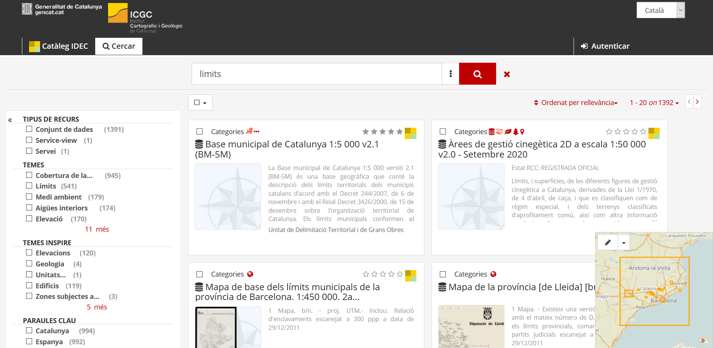
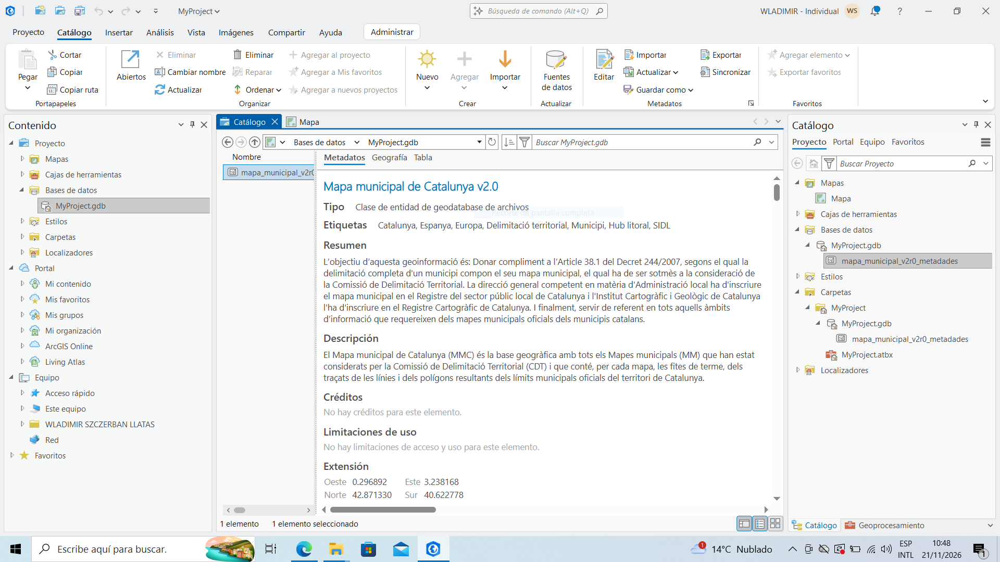
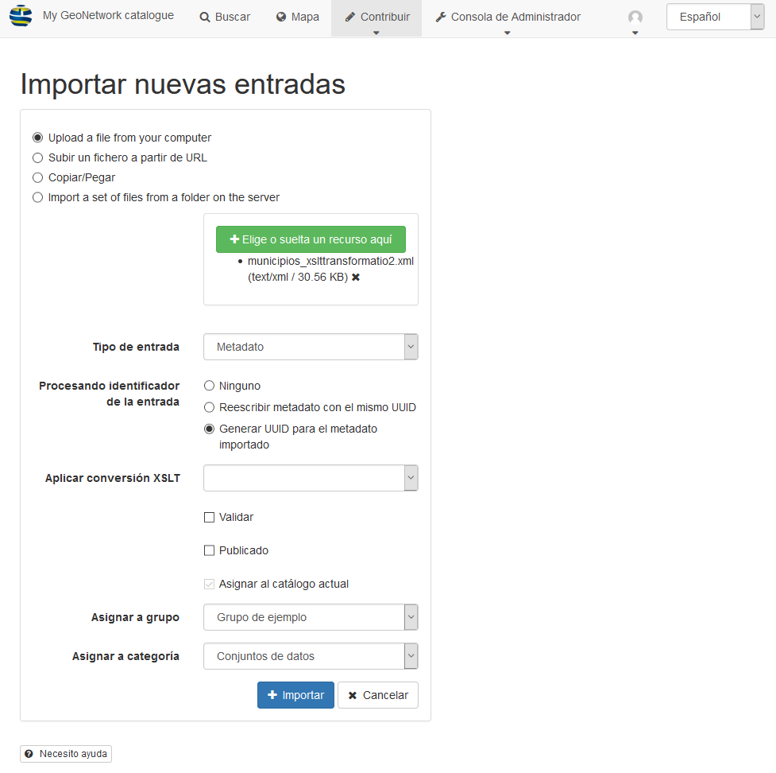
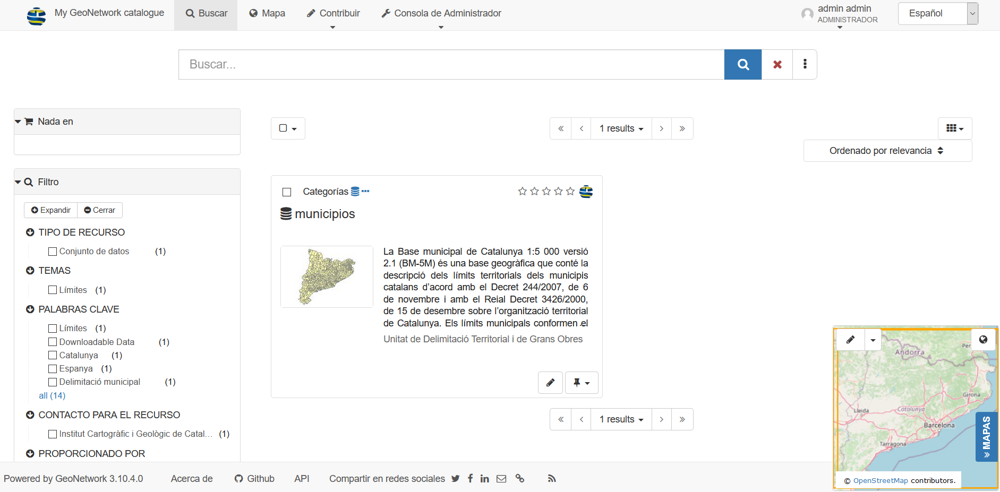

# Creación de metadatos

## Creación de metadatos desde ArcGIS

Como ya se ha comentado anteriormente la creación de metadatos de forma manual es un proceso complejo y largo por lo que la mejor forma de crearlos es mediante algún editor de metadatados.

En este caso utilizaremos el editor de metadatos que tiene integrado ArcGIS para generar un metadato mediante un ejemplo de un conjunto de datos de los límites municipales de Catalunya.

### Elegir un estilo de metadatos

La información disponible para ver y editar en la pestaña Descripción está determinada por el estilo de metadatos seleccionado. [^1]

Abra el cuadro de diálogo **Opciones** para la aplicación ArcGIS Pro for Desktop.

- En ArcGIS Pro, haga clic en **Configuracion** > **Opciones**.

Haga clic en la pestaña **Metadatos**.

En el desplegable seleccionar el estilo de metadato que se desea crear en este caso _Directiva de metadatos de INSPIRE_

### Descargar la capa de información y el metadato correspondiente.

Ir a la web de la [Infraestructura de Dades Espacials de Catalunya (IDEC)](https://ide.cat/)

En el catálogo de metadatos buscar _limits_

Seleccionar el primer resultado **Mapa municipal de Catalunya v2.0**

Resultado de búsqueda

Al seleccionar el metadato nos abre una página con el [detalle del metadato](https://catalegs.ide.cat/geonetwork/srv/cat/catalog.search#/metadata/mapa-municipal-v2r0).

Para descargar los datos ir al apartado de **Descàrregues i enllaços** del metadato y presionar el botón de _Obrir enllaç_ que aparece junto a **Descàrrega SHP**

Para descargar el metadato ir al apartado de **Informació de la metadada** y presionar el enlace **Descarregar metadata**

### Cargar la capa en ArcGis e importar el metadato

#### Cargar la capa

Dentro del archivo (zip) de datos descargado hay una shapefile. Seleccionaremos el archivo llamado _mapa-municipal-v2r0-metadades.shp_

Cargarmos el shapefile dentro de nuestra geodatabase podemos llamarla **municipios** (también se puede cargar el shapefile directamente). Y luego cargamos la capa en el mapa.

Una vez cargada la capa de municipios en el mapa presionamos con el botón derecho sobre la capa y vamos a _Ver metadatos_. Esto nos abre una ventana nueva con el metadato de la capa.

Podemos ver que en el metadato ya hay algunos datos extraídos automáticamente de la información de la capa, pero vemos que faltan muchos otros datos.

Si presionamos el botón de _Editar metadatos_ nos muestra el formulario de edición del metadato y nos indica todos los campos que faltan por rellenar para cumplir con el estilo de metadato seleccionado.

#### Importar el metadato

Abrimos el ArcCatalog y buscamos la capa de municipios hacemos click.

Presionamos el botón de _Importar_ y nos muestra el formulario de importación. En el campo de Importar metadatos desde seleccionamos el archivo xml descargado de la IDEC. En el tipo de metadatos dejamos la opcion de INSPIRE.

Una vez terminado el proceso podemos ver que se han rellenado muchos de los campos del metadato.

Importar metadato

##### Completar la información que falta por rellenar

###### Temas y palabras claves

- **Unidades administrativas**

Se pueden buscar los temas en [GEMET](https://www.eionet.europa.eu/gemet/es/inspire-themes/)

###### Overview

- **Cite** -> Nuevo identificador -> Código = bmv2

###### Metadatos

- **Detalles** -> Idioma = Español; Castellano

###### Recursos

- **Restricciones**
  - En limitacione y condiciones de INSPIRE -> Empty
  - En restricciones legales -> Otras nuevas restricciones = CC BY 4.0
  - Luego volver a seleccinar los valores de no limitaciones y no condiciones
- **Calidad** -> Informe -> Resultado de conformidad -> Explicación = Todo correcto
- **Distribución** -> Formato de distribución -> Version de formato = 1
- **Campos** -> Detalles: municipios
  - _Tipo de entidad_ -> Definicion = Polígonos de límites municipales
  - _Tipo de entidad_ -> Fuente de definicion = ICGC
  - Atributo:CODI_UNIT -> Definicion = Código INE municipal
  - Atributo:CODI_UNIT -> Fuente de definicion = INE

### Ejercicio

!!! question "Completar una ficha de metadatos en ArcGIS — 1 punto"

    Completa en ArcGIS los campos pendientes de la ficha de municipios siguiendo las indicaciones de esta práctica. Antes de terminar, comprueba que todos los apartados obligatorios aparecen validados.

    **Entrega:** un archivo ZIP con la exportación XML del registro y una captura de ArcGIS donde se vea la ficha y la validación de sus apartados.

## Exportación desde ArcGIS e importación en GeoNetwork

### Exportar el metadato

Abrimos el ArcCatalog y buscamos la capa de municipios hacemos click.

Presionamos el botón de _Export_ dejamos las opciones de contenido y tipo de metado que nos pone por defecto y seleccionamos el archivo de salida.

Una vez finalizado el proceso cerramos la ventana desplegada por el proceso de exportación y la ventana del metadato.

### Importación en GeoNetwork

Abrimos en nuestro navegador el GeoNetwork http://localhost:8080/geonetwork.

Nos identificamos como administrador en el GeoNetwork

En el menú de _Contribuir_ seleccionar la opción de **Importar nuevas entradas**. Nos muestra un formulario que rellenaremos con los siguientes valores:

1. Seleccionar _Upload a file from your computer_ y seleccionar el archivo exportado desde ArcGIS.
2. _Tipo de Entrada_ seleccionar Metadato
3. _Procesando identificador de la entrada_ seleccionar Generar UUID para el metadato importado
4. _Asignar a categoría_ seleccionar Conjunto de datos
5. Presionar el botón de Importar

Importar metadato GeoNetwork

En el menú seleccionamos la opción de Buscar y vemos que nos aparece nuestro metadato.

### Agregar la imagen de la vista previa

Presionamos el botón de editar que aparece en el metadato y nos muestra el formulario de edición de metadatos.

En el apartado de _Visión de Conjunto_ seleccionar una imagen descriptiva del conjunto de datos.

<!-- prettier-ignore -->
!!! note "Nota"
    Esta imagen se puede generar desde el ArcGIS o con una captura de pantalla

Una vez cargada la imagen presionar el botón de _Guardar y cerrar_

Volvemos a la pantalla de Buscar y vemos que ahora aparece la imagen en nuestro metadato.

Metadato con imagen

## Referencias

[^1]: https://desktop.arcgis.com/es/arcmap/10.3/manage-data/metadata/what-is-metadata.htm

Consulta también [Qué son los metadatos](metadatos.md), el [catálogo de metadatos](catalogo_metadatos.md) y los [estándares de metadatos](estandares_ISO.md).

**Siguiente:** [Iniciativas de IDE y marco legal](iniciativas_ides.md).
