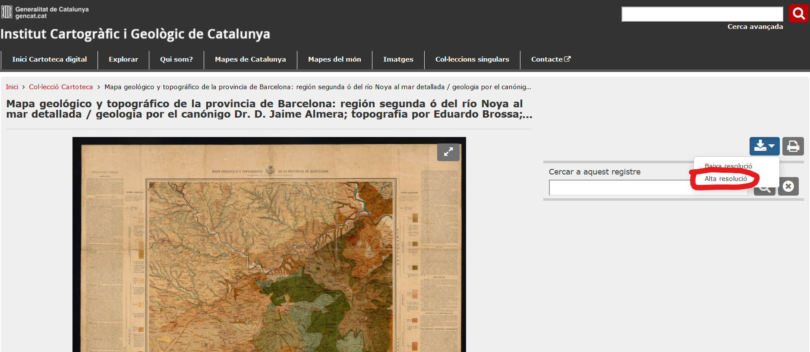
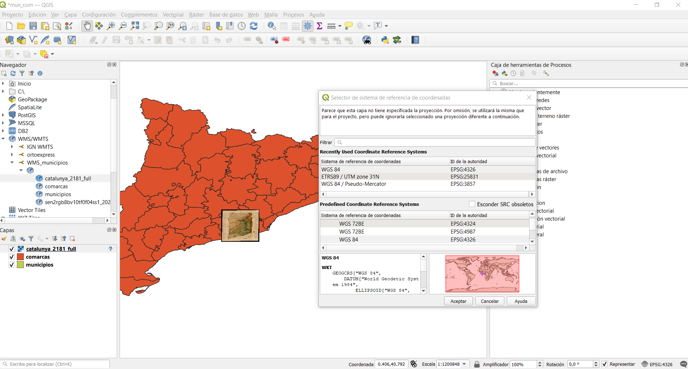
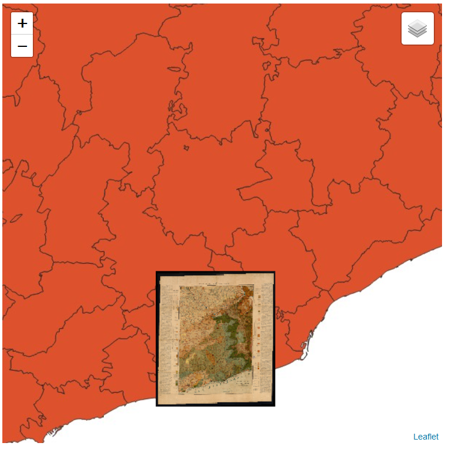

# Práctica: georreferenciar una imagen histórica

!!! note "Material trasladado para revisar"
    Esta práctica se ha separado de la lectura de servidores de mapas para revisarla más adelante. Conserva el procedimiento anterior; convendrá revisar el conjunto de datos, las instrucciones y las capturas antes de usarla en clase.

## Descargar una imagen de la Cartoteca

1. Abrir la [Cartoteca Digital del ICGC](https://cartotecadigital.icgc.cat/).
2. Buscar **Trullás** y localizar el mapa *Mapa geológico y topográfico de la provincia de Barcelona: región segunda o del río Noya al mar*.
3. Abrir la ficha del mapa y descargar la imagen en alta resolución.

   

## Georreferenciar la imagen en QGIS

4. Abrir la imagen en la herramienta de georreferenciación de QGIS y asignar puntos de control identificables en la imagen y en una capa de referencia.
5. Ejecutar la georreferenciación y guardar el resultado en un sistema de referencia adecuado para el territorio.
6. Añadir la imagen georreferenciada a QGIS y comprobar su posición respecto a otras capas.

   

## Ejercicio de integración

!!! question "Georreferenciar e integrar una imagen histórica — 4 puntos"
    Este ejercicio combina la imagen georreferenciada con el WMS de comarcas creado en la [práctica de QGIS Server](qgis_server.md).

    - Crear un visor con Leaflet que muestre el WMS de comarcas. **(2 puntos)**
    - Añadir la imagen georreferenciada como una capa superpuesta en el visor. **(0,5 puntos)**
    - Aplicar transparencia a la capa de imagen. **(0,5 puntos)**
    - **Extra:** añadir un control de capas para activar y desactivar la imagen. **(1 punto)**

    **Entrega:** un archivo ZIP con el HTML del visor, la imagen georreferenciada y cualquier archivo auxiliar que necesite para mostrarse (por ejemplo, el archivo de georreferenciación). Añade una captura del resultado abierto en el navegador. Incluye un `LEEME.txt` con instrucciones para abrirlo y las fuentes de la imagen y del WMS. El control de capas se describe en la [documentación de Leaflet](https://leafletjs.com/reference.html#control-layers).

    

**Siguiente:** [Publicar un archivo geográfico en GitHub Pages](publicar_geojson_estatico.md).
