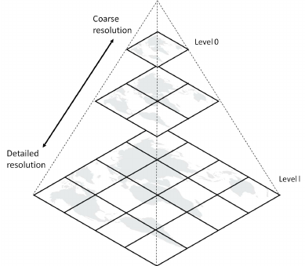

# Pirámides de teselas ráster: XYZ, WMTS y OGC API – Tiles

Una **tesela** es una imagen pequeña que representa una parte de un mapa. Un cliente web solicita las teselas que necesita para la zona visible y las coloca juntas. Al desplazarse o cambiar el zoom, solicita otras. En una pirámide, cada nivel ofrece una escala o resolución distinta: al aumentar el detalle, el territorio se divide en más teselas.



En el esquema, el nivel superior representa una vista general con poco detalle; los niveles inferiores muestran más detalle y contienen más teselas. Para una cuadrícula global Web Mercator, el nivel de zoom `z` tiene `2^z` columnas y `2^z` filas: en `z=0` hay una tesela y en `z=3` hay una matriz de 8 × 8.

Las teselas ráster suelen ser imágenes PNG o JPEG. El cliente las compone en pantalla como un mapa. La imagen ya contiene la representación cartográfica; no conserva las geometrías vectoriales ni los atributos de los objetos.

## Direcciones XYZ: `z/x/y`

La convención se suele llamar **XYZ** por los componentes de la URL; a veces se describe como el orden Z-X-Y. No es un formato de archivo. La dirección de una tesela suele tener esta forma:

```text
https://servidor/{z}/{x}/{y}.png
```

- `z` es el nivel de zoom o matriz.
- `x` identifica la columna de la tesela.
- `y` identifica la fila.
- `.png` indica el formato de la imagen; también puede encontrarse `.jpg` u otro formato.

Por ejemplo, [abrir la tesela `3/2/4` de OpenStreetMap](https://tile.openstreetmap.org/3/2/4.png) solicita una imagen del nivel `z=3`, columna `x=2`, fila `y=4`. En XYZ el origen está arriba a la izquierda: las filas aumentan hacia abajo. En una cuadrícula Web Mercator global, a ese nivel hay ocho columnas y ocho filas.

XYZ es una **convención de direccionamiento**, no un formato de imagen ni un estándar OGC. Es frecuente en mapas web, pero antes de conectar un servicio hay que comprobar su plantilla de URL, el sistema de referencia, los niveles disponibles y el sentido de la fila `y`.

### XYZ y TMS: cuidado con la fila `y`

El esquema TMS comparte una estructura de matrices y suele usar direcciones por nivel, columna y fila, pero numera las filas desde abajo. XYZ las numera desde arriba. Para una matriz cuadrada de nivel `z`, el índice invertido se calcula así:

```text
y_TMS = 2^z - 1 - y_XYZ
```

Por ejemplo, en el nivel `z=3`, la fila `y=4` de XYZ corresponde a la fila `y=3` de TMS. Si se conectan esquemas con diferente origen sin invertir la fila, las teselas aparecen en lugares incorrectos o el mapa no se dibuja bien.

Aquí se puede ver una comparación entre los valores de los indices de las teselas de Google (ZXY) y TMS. https://www.maptiler.com/google-maps-coordinates-tile-bounds-projection

## Cómo se relaciona con WMTS

**WMTS** (_Web Map Tile Service_) es el estándar OGC para publicar teselas de mapas. El cliente puede solicitar la descripción del servicio y luego pedir una tesela usando, entre otros datos, la capa, el estilo, el formato y el sistema de matrices de teselas. La operación `GetTile` puede expresarse como una petición por parámetros (KVP) o mediante una plantilla de URL RESTful.

Una petición WMTS por parámetros suele incluir valores como:

```text
SERVICE=WMTS
REQUEST=GetTile
VERSION=1.0.0
LAYER=...
STYLE=...
FORMAT=image/png
TILEMATRIXSET=...
TILEMATRIX=...
TILEROW=...
TILECOL=...
```

`TILEMATRIX`, `TILEROW` y `TILECOL` desempeñan un papel parecido a zoom, fila y columna. Sin embargo, sus identificadores y valores se consultan en la descripción del servicio: no hay que asumir que cualquier URL XYZ se puede convertir a WMTS cambiando solo el orden de `x` e `y`. El conjunto de matrices (_Tile Matrix Set_) describe el CRS, el origen, el tamaño y la resolución de cada matriz.

WMTS complementa a WMS. Con WMS se solicita una imagen para una extensión y un tamaño concretos; con WMTS se piden imágenes de una cuadrícula y escalas definidas. Las teselas suelen poder reutilizarse y almacenarse en caché, lo que hace eficiente la navegación. A cambio, el cliente se ajusta a las matrices, escalas y estilos que publica el servicio.

## ¿Y OGC API – Tiles?

[OGC API – Tiles](https://ogcapi.ogc.org/tiles/) es el estándar OGC moderno relacionado con la distribución de teselas y se plantea como sucesor de WMTS. **Part 1: Core, versión 1.0.0, está aprobado.** Comparte la idea de matrices de teselas con WMTS, pero presenta recursos web que se pueden descubrir mediante enlaces y documentar con OpenAPI. Además de mapas ráster, puede servir teselas vectoriales, coberturas y otros datos teselados.

El cliente descubre los conjuntos de teselas y sus sistemas de matrices en la API. Una ruta de tesela habitual sigue esta estructura:

```text
.../tiles/{tileMatrixSetId}/{tileMatrix}/{tileRow}/{tileCol}
```

El nombre de cada matriz y el orden se especifican en la plantilla que anuncia el servicio. En el patrón anterior, la ruta coloca primero la fila y luego la columna; por eso no es idéntica a la dirección XYZ `z/x/y`. La matriz común Web Mercator permite relacionar los mismos índices geográficos, pero hay que respetar el orden descrito por el servicio.

## Ejemplos de peticiones reales

### WMTS del IGN

El servicio [WMTS del mapa base del IGN](https://www.ign.es/wmts/ign-base) publica la capa `IGNBaseTodo`. Puedes abrir su [documento `GetCapabilities`](https://www.ign.es/wmts/ign-base?SERVICE=WMTS&REQUEST=GetCapabilities) y buscar la capa, el estilo y los sistemas de matrices disponibles.

Esta petición solicita una tesela JPEG del nivel `15` del sistema `EPSG:4258`:

[Abrir petición `GetTile` del WMTS del IGN](https://www.ign.es/wmts/ign-base?SERVICE=WMTS&VERSION=1.0.0&REQUEST=GetTile&LAYER=IGNBaseTodo&STYLE=default&FORMAT=image/jpeg&TILEMATRIXSET=EPSG:4258&TILEMATRIX=15&TILEROW=9022&TILECOL=32097)

En ella, `TILEMATRIXSET=EPSG:4258` identifica la cuadrícula; `TILEMATRIX=15`, el nivel; y `TILEROW=9022` y `TILECOL=32097`, la fila y columna. Es un ejemplo publicado por el Centro Nacional de Información Geográfica (CNIG) en su [guía de servicios web de CartoCiudad](https://www.idee.es/resources/documentos/Cartociudad/CartoCiudad_ServiciosWeb.pdf).

Si una petición de tesela no carga, abre primero la descripción del servicio y comprueba que el tileset, la matriz, el formato y las coordenadas estén anunciados por el servidor. Las URL concretas y los recursos disponibles pueden cambiar.

| Aspecto                           | XYZ                                                                             | WMTS                                                                      | OGC API – Tiles                                                                                  |
| --------------------------------- | ------------------------------------------------------------------------------- | ------------------------------------------------------------------------- | ------------------------------------------------------------------------------------------------ |
| **Qué es**                        | Convención de URL habitual, normalmente para teselas ráster en Web Mercator.    | Estándar OGC de servicio de teselas de mapas.                             | Estándar OGC de API web para descubrir y solicitar teselas.                                      |
| **Cómo se descubre**              | A menudo se configura con una plantilla de URL y datos conocidos del proveedor. | Mediante las capacidades del servicio y su `TileMatrixSet`.               | Mediante la página inicial, enlaces, descripción de API y metadatos de los conjuntos de teselas. |
| **Cómo se identifica una tesela** | `{z}/{x}/{y}`; normalmente `y` parte de arriba.                                 | `TileMatrix`, `TileRow`, `TileCol`, definidos por el sistema de matrices. | `tileMatrix`, `tileRow`, `tileCol`, según la plantilla y el sistema de matrices anunciados.      |
| **Contenido**                     | Habitualmente imágenes PNG o JPEG.                                              | Teselas de mapas, normalmente imágenes.                                   | Teselas ráster, vectoriales, de coberturas y otros tipos admitidos.                              |
| **Estado**                        | Convención de facto; no es un estándar OGC.                                     | Estándar OGC WMTS 1.0.0.                                                  | OGC API – Tiles Part 1: Core 1.0.0, estándar aprobado.                                           |

## Prueba rápida: leer una dirección XYZ

**Objetivo:** reconocer el nivel, columna y fila de una petición de tesela.

1. Abre la [tesela de ejemplo](https://tile.openstreetmap.org/3/2/4.png).
2. Identifica `z`, `x` e `y` en la URL y explica qué representa cada número.
3. Para `z=3`, calcula cuántas filas y columnas tiene la matriz global.
4. Indica qué fila correspondería a `y=4` si el servicio usara el esquema TMS.

**Resultado esperado:** nivel 3, columna 2, fila XYZ 4; matriz de 8 × 8 teselas; fila TMS 3.

**Reflexión:** ¿qué comprobarías en los metadatos antes de usar una plantilla XYZ que has encontrado en un geoportal?

Continúa con [la transición de los servicios clásicos a las OGC API](api.md).

## Fuentes

- [OGC: estándar WMTS](https://www.ogc.org/standards/wmts/), versión 1.0.0.
- [OGC: OGC API – Tiles](https://ogcapi.ogc.org/tiles/), Part 1: Core, versión 1.0.0.
- [OGC: Two Dimensional Tile Matrix Set and Tile Set Metadata](https://www.ogc.org/standards/tms/).
- [CNIG: Servicios web de CartoCiudad](https://www.idee.es/resources/documentos/Cartociudad/CartoCiudad_ServiciosWeb.pdf), ejemplo de petición `GetTile` al WMTS del IGN.
- [OpenStreetMap Wiki: nombres de teselas _slippy map_](https://wiki.openstreetmap.org/wiki/Slippy_map_tilenames).
- [OSGeo: especificación TMS y origen inferior izquierdo](https://wiki.osgeo.org/wiki/Tile_Map_Service_Specification).
