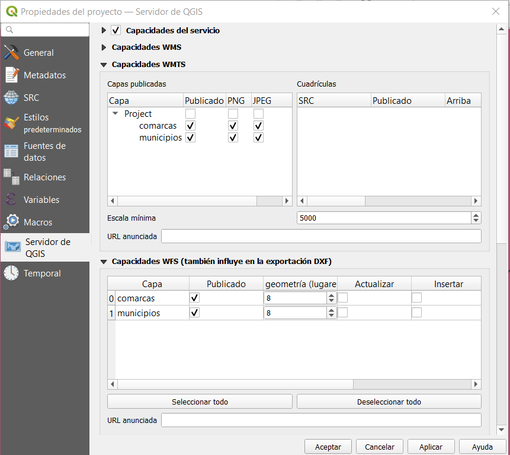
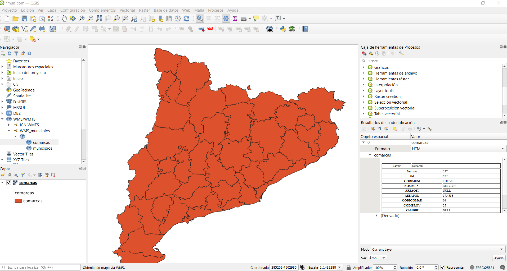
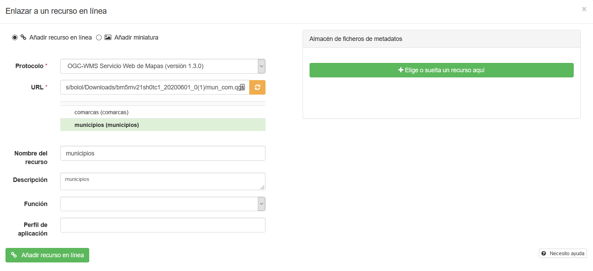

# Práctica: publicar un proyecto con QGIS Server

!!! note "Material trasladado para revisar"
    Esta práctica se ha separado de la lectura de servidores de mapas para revisarla más adelante. Conserva el procedimiento anterior, que depende de QGIS Server, Apache y XAMPP en Windows; algunos pasos e imágenes pueden corresponder a versiones antiguas.

## Preparar el proyecto

1. Abrir un proyecto nuevo en QGIS.
2. Cargar la capa de municipios descargada del ICGC.
3. Generar la capa de comarcas a partir de la capa de municipios.
4. Aplicar estilo a ambas capas.
5. Guardar el proyecto como `mun_com.qgs`.
6. Abrir las propiedades del proyecto y entrar en la pestaña **Servidor**.
   - Activar las capacidades del servicio.
   - En las capacidades WMTS, marcar como publicadas las capas y seleccionar PNG y JPEG.
   - En las capacidades WFS, marcar como publicadas las capas.

   

## Iniciar y consultar QGIS Server

7. Iniciar Apache desde el panel de control de XAMPP.
8. Abrir en el navegador la dirección local de `GetCapabilities`:

   ```text
   http://localhost/cgi-bin/qgis_mapserv.fcgi.exe?SERVICE=WMS&VERSION=1.3.0&REQUEST=GetCapabilities
   ```

9. Consultar las capacidades del proyecto indicando su ruta:

   ```text
   http://localhost/cgi-bin/qgis_mapserv.fcgi.exe?SERVICE=WMS&VERSION=1.3.0&REQUEST=GetCapabilities&map=[RUTA_DE_ARCHIVO]/mun_com.qgs
   ```

10. Crear un proyecto QGIS nuevo y conectarlo al WMS local. Si la orientación del mapa parece incorrecta, revisar el CRS y el orden de ejes de la petición.

    

## Enlazar el servicio al metadato

11. En GeoNetwork, editar el metadato «municipio» y añadir un recurso en línea:

   - En **Recursos asociados → Recursos en línea**, seleccionar el protocolo WMS.
   - Indicar la URL del servicio. Por ejemplo:

     ```text
     http://localhost/cgi-bin/qgis_mapserv.fcgi.exe?VERSION=1.3.0&map=[RUTA_DE_ARCHIVO]/mun_com.qgs
     ```

   - Seleccionar la capa de municipios y añadir el recurso.

   

!!! warning "Solo accesible desde el equipo local"
    Una URL que contiene `localhost` solo es accesible desde el propio ordenador. No permite que otros estudiantes o usuarios de Internet consulten el servicio; para compartirlo habría que desplegarlo en un servidor accesible y configurado para ello.

**Siguiente:** [Georreferenciación](georeferenciacion.md).
